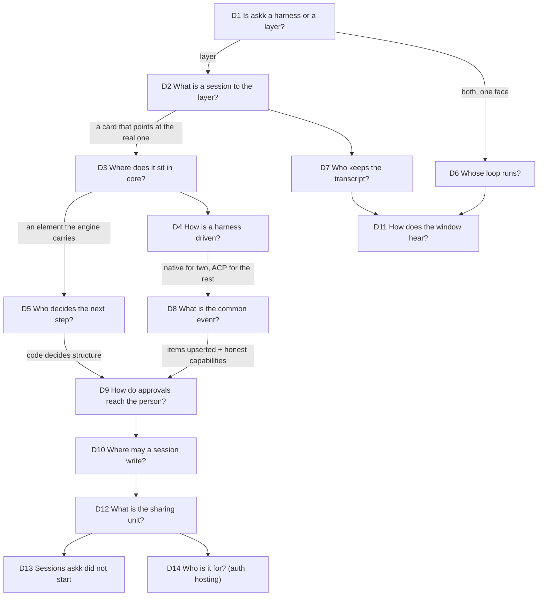

# 002 Decisions: the chart

Fourteen decisions, in the order they constrain each other. The evidence behind each row is in
`001-evidence.md`. "Cost to change" says how expensive it is to be wrong, which is what decides
how carefully to choose.

## The order

## The chart

### D1. Is askk a harness, or a layer over harnesses?

| option | who does it | for | against |
| --- | --- | --- | --- |
| A harness (own loop, own tools) | DSH, Claude Code, Codex, askk today | full control of the loop | you compete with large teams on tools, sandboxing and context handling |
| A layer (no loop) | T3 Code | small; rides every harness improvement | nothing of your own to say: no loops, no personalization |
| **A layer that also carries its own loop behind the same face** | dsh-superagent (an app *on* DSH: it routes, DSH runs the loop) | real sessions do the work; your loop decides what work, for whom, when | two entry points to keep honest (D6) |

**Pick: the third.** Cost to change: very high (it is the product).

### D2. What is a session to the layer?

| option | who does it | for | against |
| --- | --- | --- | --- |
| A model call (`Infer::complete`) | askk today (`models.json`: `claude -p --tools ""`) | already works | throws the session away: no events, no approvals, no resume |
| A full copy the layer owns | T3 Code (event log + about 15 projection tables) | fast UI, provider switch, history offline | the copy must cover every harness; one stored event that cannot be decoded can stop startup |
| **A card that points at the real session** | dsh-superagent (ticket and session are separate; DSH keeps the transcript) | small state; the harness stays the truth | history depends on the harness being readable (D7) |

**Pick: a card.** `{id, harness, native ref, where, title, status}`. Our id is identity; the
harness's id is evidence (T3's rule). Cost to change: high.

### D3. Where does the session sit in the core?

| option | for | against |
| --- | --- | --- |
| Behind `Infer` | no new concept | see D2; the engine would wait minutes inside `Think` |
| A sub-engine (`Engine::subs`) | an engine is already a tool | a session has no elements, prompt or flow: an engine in name only |
| A new top-level object beside engines | clean | a second lifecycle, a second boot path, a second place for state |
| **One element kind the engine carries (`sessions`)** | every rule already holds: optional, config + state, `on(Event)`, tools, view, saved as a Spec | one new `Event` variant; cards live in that element's state |

> **Superseded 2026-11-10 by `007-workflow.md`:** a session is a peer of an engine, with its own
> inbox; the "second lifecycle" objection is met by giving both the same one.

**Pick: an element.** This is the sentence "the engine carries sessions" made literal. The
engine owns the work (dsh's ticket); a session is who does it this time (dsh's assignment).
Cost to change: high.

### D4. How is a real harness driven?

| option | who does it | for | against |
| --- | --- | --- | --- |
| A terminal, scraped | early wrappers | works with anything | no structure, no approvals, breaks on every release |
| The vendor SDK in a Node sidecar | T3 Code (Claude Agent SDK, Cursor SDK, OpenCode SDK) | least protocol work | a second runtime to ship and sandbox; the SDKs spawn the CLI anyway |
| ACP for everything | Zed | one adapter | loses Claude's hooks, structured questions, rewind and subagent tree; loses Codex's steer, fork and review; both need a Node adapter in between |
| **The harness's own wire for Claude and Codex; ACP for the rest** | T3 Code (the same split) | full capability where it matters; the long tail for one adapter | three adapters, not one |

**Pick: native + ACP.** Claude: `claude -p --input-format stream-json --output-format stream-json`
with its control protocol. Codex: `codex app-server` (JSON-RPC; its schema can be generated).
Grok Build, Gemini, Cursor, OpenCode: ACP. Cost to change: low per adapter (one file each).

### D5. Who decides the next step: code or the model?

| option | who does it | for | against |
| --- | --- | --- | --- |
| The model routes and gates | most agent frameworks | flexible | a prompt edit changes what is enforced |
| A workflow graph | n8n-style tools | visible | already refused by you: user code in disguise |
| **Code decides structure; the model decides meaning, through tools** | dsh-superagent; askk (`core/flow.rs`) | enforcement cannot be talked out of | every new structural wish is code |

**Pick: unchanged.** Who may start a session, where it may write, who may answer an approval:
code and checked values. What to ask a session to do: the model. Cost to change: very high.

### D6. Whose loop runs when the person types?

| option | for | against |
| --- | --- | --- |
| Always the engine's loop, which relays | one path | a model in the middle of every message: slow and lossy |
| Always the session; engines only watch | what T3 Code does | no layer capability |
| **The person talks to whom they address** | dsh's rule: a message on a worker's own thread goes to that worker, not through the router | two entry points into one element |

> **Sharpened 2026-11-10 by `007-workflow.md`:** one door, not two. Everything is an envelope
> to an address; the reply goes to its sender.

**Pick: addressed.** Talking to a session goes straight to it (T3 mode). Talking to the engine
runs the engine, which may use its session tools (dsh mode). Both end in the same `on(Event)`.
Cost to change: medium.

### D7. Who keeps the transcript?

| option | for | against |
| --- | --- | --- |
| The layer, as state | what T3 Code does | see D2 |
| **The harness; the layer keeps a cache of what it saw** | restart-safe without a schema; the backup stays small | a session askk did not start needs a tolerant reader; Claude's file format is not documented |

**Pick: harness + cache.** The cache is not state: deleting it loses nothing the harness cannot
give back. Cost to change: medium (a durable log later is additive).

### D8. What is the common event?

| option | who does it | for | against |
| --- | --- | --- | --- |
| Raw frames passed up | no one who lasted | no mapping | the UI learns every harness |
| The union of every harness's events | — | nothing lost | every new harness changes the core type and the UI |
| **Whole items, upserted, plus honest capability flags** | T3 Code V2 (`X.updated` + `turn.terminal`, 12 capability groups); ACP (`session/update`) | live and replay are the same code; a missing ability is hidden, never imitated | deltas are coalesced in the adapter |

**Pick: items + capabilities.** An item is `{id, kind, status, text, detail}` with kind in
`said | thought | tool | ask | plan | note`. A turn starts, and ends with a reason. Everything
else a harness can do is a flag: resume, fork, steer, questions, always-allow, subagents, rewind,
found. Cost to change: very high after the third adapter, cheap before it. Freeze it late.

### D9. How do approvals and questions reach the person?

| option | for | against |
| --- | --- | --- |
| Run with permissions skipped | no work | no trust; the first bad command ends the project |
| The engine's model answers | autonomy | D5: the model must not gate |
| **The layer is the permission host; each request is an ask that states how it can be answered** | T3 Code (`RuntimeRequest`: `live`, `message` or `not_resumable`); dsh (one structured question; the panel lists what waits first) | the Asks page and the Dock badge already exist | a request whose process died must say so, not pretend |

**Pick: asks.** A rule that lets an engine answer for the person is a checked value in the
element's config, off by default. Cost to change: medium.

### D10. Where may a session write?

| option | who does it | for | against |
| --- | --- | --- | --- |
| Anywhere the user can | dsh-superagent (its docs admit workers run as the operator) | nothing to set up | one prompt injection away from a bad day |
| A git worktree per session | dsh (per ticket), T3 Code (launch strategy) | parallel work without collisions | needs git and a setup step per project |
| **Inside the app's home, under the existing Seatbelt profile** | askk today | built, and verified with the `claude` CLI | each harness needs its own config folder opened in the profile |

**Pick: the home first, worktrees after.** Sessions are children of the sandboxed host, so they
inherit its walls. A worktree is later a value on the card (`where`), not a new concept.
Cost to change: low.

### D11. How does the window hear about a session?

| option | for | against |
| --- | --- | --- |
| A socket with snapshot + cursor | what T3 Code does; right for per-token streaming | a new transport and its failure modes |
| **The existing change feed, items coalesced** | one listener per tab already; `architecture.md` says a socket later changes two places | text arrives in small steps, not per token |

**Pick: the feed first.** Mark `sessions/<id>`; the view asks for the items after the last one it
has. Cost to change: low (already isolated).

### D12. What is the unit of personalization and sharing?

| option | who does it | for | against |
| --- | --- | --- | --- |
| Plugins as code | DSH (about 200 `dsh-*` plugins; a profile is a list of bundles plus one patch file) | anything can be replaced | needs a dynamic language; Rust has no cheap equivalent; you ruled out user code |
| Settings | T3 Code (`settings.json`, `t3.json`) | simple | nothing to share: a setup is not a thing |
| Only the harness's own unit | Claude and Codex plugins, `SKILL.md`, `AGENTS.md` | an ecosystem already | says nothing about engines, pages, loops |
| **A pack: a layer of store keys, read under the personal layer and over the defaults; harness units travel inside it** | dsh's idea in askk's material: `Spec` files, templates, `export()` | a setup becomes a folder you can hand over; an override remembers what it replaced | boot stops copying defaults and starts reading through layers: your decision |

**Pick: packs.** Cost to change: medium. It also removes a known limit: today a new default
inside an existing folder never arrives, because seeding copies.

### D13. Sessions askk did not start

| option | for | against |
| --- | --- | --- |
| Ignore them | simple | "connect other sessions" is half the wish |
| Take them over | — | another process owns them; T3 Code refuses this case outright |
| **List them, read them, resume them as ours; never drive one that another process holds** | T3 Code (`agentSessions.scan/import`); Codex `thread/list` and `thread/read`; Claude's session files and live registry | a capability (`found`): not every harness has it |

**Pick: find and import.** Cost to change: low.

### D14. Who is it for?

| option | for | against |
| --- | --- | --- |
| Hosted for other people | reach | Codex's docs say app-server login was never permitted for hosted services; Anthropic does not let third parties offer claude.ai login; isolating users becomes your job |
| **One person, their own machine, their own logged-in CLIs** | what you decided on 2026-11-09 | sharing is of setups (D12), never of sessions or logins |

**Pick: personal.** Cost to change: very high. "A website where someone drops their data"
survives only as "they run their own copy".

## What the picks add up to

| | count |
| --- | --- |
| new concepts | 4: harness, session, ask (made structured), pack |
| new ports in `core` | 1 (`Harness`) |
| new element kinds | 1 (`sessions`) |
| new `Event` variants | 1 |
| new host files | 1 per harness + 1 that keeps them alive |
| ideas retired | reaching Claude Code only as a model, with its tools switched off |
